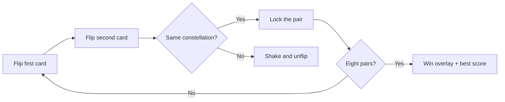

# Nebula Match

**Flip the stars. Find every pair. Beat your best.**

A cosmic memory game in the browser — 16 cards, 8 constellations, and a race against your own record. No build step, no framework, no backend. Open `index.html` and play.

[](https://developer.mozilla.org/en-US/docs/Web/HTML)
[](https://developer.mozilla.org/en-US/docs/Web/CSS)
[](https://developer.mozilla.org/en-US/docs/Web/JavaScript)
[](https://developer.mozilla.org/en-US/docs/Web/API/Web_Audio_API)
[](#license)

---

## Play

| Open the file | Or serve it locally |
| --- | --- |
| Double-click `index.html` | `npx serve` then visit the printed URL |

The first click starts the timer and unlocks audio (browsers require a user gesture before sound can play).

---

## How it works

Sixteen face-down cards hide eight emoji pairs. Flip two at a time. Matches stay revealed; misses fold back after a short pause. Clear the board in as few moves as you can.



### HUD

| Stat | What it tracks |
| --- | --- |
| **Moves** | One count each time you turn a second card |
| **Time** | Elapsed seconds from the first flip |
| **Pairs** | Matches found out of eight |
| **Best** | Lowest move count stored in this browser |

A win overlay reports moves and time. If you beat your stored best, it calls it out.

---

## Features

- **3D card flips** with match glow and miss shake
- **Starfield + drifting orbs** behind a glass HUD
- **Web Audio tones** for flip, match, miss, win, and clicks — no sound files
- **Mute + volume slider** with a compressor and master gain so SFX stay audible
- **Persistent settings** for best score, mute, and volume
- **Keyboard-friendly cards** and labeled sound controls
- **Responsive 4×4 board** that stacks the HUD on small screens

---

## Project layout

```
Memory-Match/
├── index.html    # Shell, HUD, board, sound dock, win dialog
├── styles.css    # Theme, board, animations, volume control
├── script.js     # Shuffle, match logic, timer, audio
└── README.md
```

Vanilla HTML, CSS, and JavaScript. Google Fonts load **Outfit** and **Space Grotesk**.

---

## Sound

Tones are synthesized with `AudioContext` oscillators, routed through a master gain node and a dynamics compressor. Volume uses a perceptual curve (`(volume / 100)^1.4`) so the slider feels even from quiet to loud.

| Control | Behavior |
| --- | --- |
| Mute | Silence without losing the last volume |
| Slider `0%` | Mute; unmute restores **80%** |
| Slider `1–100%` | Live volume; persisted across reloads |

Stored keys:

- `memoryMatchBestScore` — fewest moves
- `nebulaMatchSound` — `on` / `off`
- `nebulaMatchVolume` — `0`–`100`

---

## Customize

Pairs live in `script.js`:

```js
const emojis = ["🌟", "🚀", "🎸", "💎", "🌈", "🔥", "🧩", "🍔"];
```

Swap the eight symbols, keep two of each on the board, and the rest of the game stays the same. Theme colors sit in `:root` in `styles.css` (`--gold`, `--cyan`, `--magenta`, and the night-sky background).

---

## License

MIT. Use it, remix it, launch it into another galaxy.